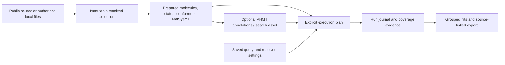

# Public-library architecture — design proposal

Owners LMMV/dprada; 2026-11-06; product destination
[#108](https://github.com/uibcdf/pharmacophoremt/issues/108), comparison evidence
[#128](https://github.com/uibcdf/pharmacophoremt/issues/128).
This proposal turns the [workflow survey](pharmacophore_library_workflow_survey.md)
and [provider research](public_library_support_research.md) into a concrete
lifecycle, user/API journey and first implementation plan. It introduces no runtime
API, persistent schema, index, dependency, provider integration or release promise.

The accepted targets are powerful capabilities with evidence, intuitive guided
use and a coherent detailed public API. Quality takes precedence over delivery
speed. Recommendations below remain design proposals; existing scientific and
ownership contracts retain their authority.

## Recommended direction and alternatives

Recommend one lifecycle with an incremental prepared-input reference route and an
optional reusable pharmacophore-search asset for repeated queries. Both preserve
the same explicit scientific settings, input/query identities and outcome meaning.
The guided route composes the public operations available to expert users.

| Alternative | Proposed disposition | Evidence still needed |
| --- | --- | --- |
| Full-library materialization for every query | Preserve existing small-batch APIs; avoid making this the sole new execution model | Explicit memory/collection-size limits |
| Incremental prepared-input evaluation | First reference/prototype route, with bounded in-flight state and durable outcomes | Identity, lazy consumption, failure accounting and recovery contracts |
| Reusable annotations and index | Keep these distinct optional assets in the lifecycle | Build/storage/repeated-query measurements and reference-equivalence |
| Hidden preparation/engine switching | Use an inspectable plan with explicit preparation, method and fallback policy | Qualified provider and capability contracts |
| Delegated indexed engine | Later optional adapter if justified | Feature/query/score/identity translation and same-problem evidence |

An annotation cache can avoid repeated perception without accelerating candidate
search; it is not automatically an index. A scan addresses memory, while indexing
can reduce repeated-query work at a build/storage cost. Neither establishes
biological predictive quality or a platform-wide billion-scale capability.

## Concepts, identity and ownership

These are conceptual records, not public Python class names. Portable manifests,
settings and results are distinct from live molecular objects, file handles and
lazy readers. Their owning persistence contracts determine what can be replayed.

| Record | Identity and information to preserve | Boundary |
| --- | --- | --- |
| Source/selection | Provider/release/access observation, native IDs/aliases, exact subset/filter, requested records and stable order | PHMT experience/provenance; reusable molecular acquisition/collections in their provider |
| Received artifact | Original bytes/hashes, media/encoding, delivery outcome, record locator and immutable manifest | Supported receiving/import tools; no consumer molecular parser |
| Prepared collection | Provider-defined molecule/state/conformer identities, source mappings, atom/frame/unit policy, resolved preparation recipe/versions, omissions and failures | MolSysMT molecular operations; PHMT eligibility and chosen recipe |
| Feature/search asset | Exact prepared parent, feature definitions/inventory, units/frames, supported constraints, algorithm/schema/build identity and coverage | PHMT pharmacophore semantics; reusable molecular perception/geometry remains provider-owned |
| Query snapshot | Detached saved model, supported constraints, tolerances/units, essential/optional/excluded rules, source identity and scoring meaning | Existing PHMT model/persistence contracts |
| Execution plan | Query/asset references, method/backend, filters, budgets, states/frames, stopping/grouping/ties, capabilities, resources and output policy | PHMT scientific orchestration |
| Run attempt and outcome | Frozen contract, stable work keys, original/evaluated/failed/pending accounting, committed results, selected witness and exports | PHMT; molecular serialization through MolSysMT |

Keep three questions separate: **content identity**, **scientific compatibility**
and **molecular equivalence**. Hashes of stored bytes answer the first, declared
preparation/feature/query contracts constrain the second, and MolSysMT owns the
third. Titles, SMILES strings, filenames, atom counts or coordinate similarity
must not become a local molecular equivalence engine.

Source records, molecules, states and conformers can have many-to-many lineage.
Keep aliases and original multiplicity even when preparation shares a molecular
object. Conformers and supplier duplicates are not automatically independent
scientific samples. A preparation request/recipe identity also differs from the
content identity of its completed or partial output; retain both.

Specify serialization/canonicalization before promising a digest-based public
manifest contract. Paths, timestamps, display labels and attempt IDs are provenance;
relocation should not masquerade as a chemical change. A hash verifies consistency,
not trustworthy origin or correct preparation. Use supported quantity records for
known dimensional fields; do not reinterpret literal text as units.

A copied query or retained molecular pointer is not a frozen molecular snapshot.
Use admitted immutable prepared artifacts or supported provider snapshot/copy
contracts for persistent assets. Preserve current intentional live-reference
workflows separately; do not claim automatic authentication, regeneration or a
PHMT molecular observer. [Live-reference contract](live_reference_ownership.md),
[native provenance](native_provenance_persistence.md).
An independent provider copy isolates ownership; immutability, persistence and
unchanged-state verification need separate supported contracts. The first controlled
prototype must state its unchanged-input precondition without claiming a reusable
authenticated snapshot implementation.

## Guided and expert journeys

| User task | Guided route to validate | Expert public operation/inspection |
| --- | --- | --- |
| Start | Select a public source, import authorized files or reopen a prepared snapshot; see operation-specific support | Inspect exact source/selection/access state and receiving/import choices |
| Preview | Known/unknown eligible records, states/conformers, failures, preparation/rebuild needs and estimated cost | Inspect provider identity/grouping, coverage, filters and estimate assumptions |
| Prepare | Choose a named policy expanded to saved effective parameters, or reuse compatible prepared data | Review exact state/stereo/conformer policy, provider operations, maps and omissions |
| Plan | Select query/method profile and see budgets, coverage and required builds | Compose/inspect query capabilities, assets, filters, search/score/aggregation/tie rules |
| Execute | Progress, cancellation and actionable recovery with confirmed work retained | Consume/persist outcomes and diagnostics; resume only a compatible run |
| Inspect/export | Grouped compound hits, matching conformers/features, negatives and unscored failures | Access per-work-unit evidence, observed/proven ranks, exact settings and supported exports |

A preview must not secretly drain a one-pass iterator. Use provider metadata or
an explicit sampling operation with a declared replay/lifetime contract; unknown
counts remain unknown. A guided Python/notebook/CLI workflow does not require a
new GUI or the deferred viewer addon.

Guided and expert composition must resolve to the **same effective scientific
settings**, not merely similar output. Presets are versioned parameter bundles.
The public route exposes the resolved values and supported controls without
requiring private modules. Keep molecular preparation, index building and optional
reranking visible in the plan while sparing routine users internal file handling.
Supplied prepared 3D must not silently trigger new geometry/state enumeration.

## Lifecycle, refresh and invalidation

Separate build state (pending/running/completed/failed/cancelled), coverage
(complete/partial/unknown), qualification and relationship to the requested version
(current/stale/superseded). These are orthogonal properties, not one success flag.

Build beside the old asset and publish a replacement only after its declared
checks. A failed refresh retains the old qualified snapshot with its date/coverage;
active runs keep their original binding. A user may deliberately use a compatible
older snapshot. Partial output does not silently replace complete input. Preserve
failed attempts and the recovery route; update a current alias explicitly.

| Change | Required reuse decision |
| --- | --- |
| Source/release/selection changes | New received identity; assess reuse of descendants |
| Preparation/state/topology/geometry or atom/frame maps change | New prepared identity; rebuild/requalify dependent features and indexes |
| Feature/perception definition or stored units/frame changes | Invalidate affected annotations/indexes; matching names do not establish compatibility |
| Query constraints, score, filters, grouping or budget changes | New plan/run; reuse upstream assets only within their supported query domain |
| Method/backend/numerical policy changes | New execution identity and reference-equivalence/precision evidence |
| Alias/display label/stock observation changes | Separate presentation/availability metadata; retain historical structural identity and dated availability |
| Storage relocation or export layout changes | Preserve scientific identity where meaning/content is unchanged; version the representation as required |

Preflight unsupported shapes/features/constraints, frame policies, query
prerequisites and parameter/quantity errors before input consumption whenever the
boundary can decide without molecular access. Current triplet searches need three
non-collinear essential centers: explain this limitation rather than invent anchors
or silently switch to placed evaluation. Index-to-native fallback requires an
explicit recorded plan policy; never drop unsupported semantics to proceed.

## Matching, aggregation and portable outcomes

Keep scientific method, compute backend and execution plan independent, as in the
[growth contracts](extensible_modeling_contracts.md). Each route records the actual
prepared state/frame, feature definitions and finite search domain.

- The reference route retains bounded in-flight input/result state; a single
  molecule and its conformer/search workload still have their own memory cost.
  Avoid retaining live molecular handles in the durable result journal. A caller
  may deliberately accumulate results outside this bounded contract.
- Bind stable work keys to the frozen selection/mapping and query. Preserve native
  pose/frame/state evidence, including nested conformer and diagnostic identities.
  Current native batches assign local ordinal IDs; offsetting only the outer
  result is inconsistent. The first adapter should use public single-input
  evaluation with explicit IDs or a separately qualified mapping contract.
- Keep status, requested/attempted/succeeded/failed coverage, enumeration
  completeness, score resolution/bound, selected observed witness and stopping
  reason separate. A seeded no-fit negative may have `fit_value=None` and score0;
  **None coverage is not a universal failure test**. A proven binary hit may resolve
  its maximum despite an incomplete ensemble. Unresolved work can retain a
  `best_observed` witness without a definitive score.
- Distinguish receiving/parser/preparation errors, unsupported inputs, search or
  resource failures, valid nonmatches and unevaluated work. Failures are unscored,
  never manufactured negatives. Preserve per-frame outcomes and original causes.
- Define first admissible, best under a stated criterion and all requested matches
  independently. Declare whether limits affect candidates, poses, conformers,
  compounds, total hits, time or trials, and whether applied before/after ranking.
  A resolved maximum does not prove the earliest tied conformer among uncomputed
  or failed frames; call it the selected observed witness unless stronger evidence
  exists. Stable manifest order, not worker completion order, controls ties.
- Stream in encounter order unless a stronger ordering proof exists. An observed
  top-K over scored records is not a proven global top-K over incomplete coverage.
  Keep scored/failed/pending denominators and any early-stop bound explicit.
- Separate source selection, provider-computed property filters, index candidate
  generation, final matching and postprocessing. Record representation/version,
  missing/non-finite policy and stage counts. Counts at record/molecule/state/
  conformer levels are not additive partitions.

An exact candidate index preserves all final-matcher answers within its qualified
domain. Compare against the declared native reference; approximate filtering needs
an explicit loss/coverage contract. RMSD, checked-pose coverage, binary seeded hits,
FitValue and minimized receptor scores are different observables.
[Existing seeded semantics](seeded_ranking_workflow.md) remain authoritative.

Current saved-result summaries require a one-to-one native-to-original mapping
and one outcome or upstream cause per original sample. State/conformer expansion
therefore needs explicit aggregation/correspondence before entering that API;
several variants must not become independent assay samples by accident.
[Saved-result contract](retrospective_result_contracts.md),
[implementation](../pharmacophoremt/validation/saved_results.py).
Opaque durable work keys and explicit native pose IDs coexist with this API's
nonnegative integer native/original ordinals; they do not silently replace its
one-to-one mapping contract.

## Journal, interruption and replay

Recommend a single-writer outcome ledger with a declared work key, attempt lineage,
validated result/output identity and verified committed visibility. Separate
started work, result payload and committed outcome; derive coverage/cursors from
confirmed commits. Incomplete/corrupt records are not committed. Repeated identical
publication can be idempotent; conflicting payloads for one committed key fail
visibly. For the first slice, a committed terminal failure remains authoritative
in that run. Retrying it creates a new linked run with the same original-source
mapping and preserved earlier failure; it is not another independent compound.

Aim initially for **at most one published terminal outcome per declared work item**,
not exactly-once computation. A crash after evaluation but before commitment may
require recomputation. Resume can recompute only uncommitted/interrupted work;
retain attempt evidence and the identity of the attempt that committed. A future
attempt-selection/run-revision model would require its own explicit contract.
Concurrency, crash/power-loss durability and distributed execution need separate
contracts/tests. Existing native JSON/YAML writers validate/encode before open;
they do not provide atomic replacement or checkpoint transactions.
[Native writer boundary](native_schema.md#writer-failure-boundary).

Resume verifies input/query/preparation/index/method/settings/grouping/numerical
compatibility and committed output integrity. A changed query/budget/seed normally
starts a new linked run; any continuation policy must be declared. Reuse the saved
query artifact rather than assume reserialization of a mutable object reproduces
its bytes. Keep original attribution on replay rather than credit new science.

Readers own their seek/replay/lifetime contracts. If seeking is unavailable,
reopen/verify the immutable source and skip confirmed stable keys; an integer
offset does not authenticate order/content. Closing a screen stops further pulling;
caller-owned source closure follows its ownership contract. Evidence replay needs
no molecular access; scientific reexecution records a new qualified attempt.

## Recommended first vertical slice

Use already qualified prepared analytical fixtures and existing public single-input
native evaluators to establish the reference route before choosing an index.
This is a proposed prototype, not a frozen facade, journal implementation or new
provider integration.

| Increment | Concrete result | Acceptance before broadening |
| --- | --- | --- |
| A. Frozen worked contract | Small positive/negative/failure/repeated-source and multi-conformer cases with expected answers, query/input/plan identities and provider context | Identity/coverage/score/witness/count expectations agree with current public native contracts |
| B. Incremental reference prototype | Public single-input evaluations in stable order with portable outcomes, no full-library materialization | Lazy consumption, source lifetime/closure, nested identity, failures and small-batch equivalence |
| C. Recovery and repeat-query | Interrupt/restart and a second query against the same prepared snapshot | No skipped/duplicate confirmed outcomes; mismatch/corruption detection; guided/composed settings and answers agree |
| D. Small real collection | Prospectively declared permitted public subset or authorized files, original bytes/IDs and supported MolSysMT import/preparation | No replacement of missing records or silent 2D/state/conformer fallback; complete stage accounting |
| E. Reusable search experiment | Compare annotations/cache/index alternatives against the same prepared reference problem | Equivalent qualified answers or explicit approximation; build/disk/memory/cold/warm/repeated-query cost justifies the next choice |

A tiny PubChem3D sample remains a receiving candidate, not an admitted dataset or
benchmark. Generic acquisition/collection gaps need owning molecular-provider
contracts, not a PHMT parser/downloader. Synthetic controls and an unlabeled public
sample cannot replace #103/#66/#106's separate source/endpoint/exposure/cohort
admission or biological validation.

Meaningful first cases include a query typo on empty/one-pass input, an unsupported
query, a true negative, a budget failure, a proven hit with failed conformers,
repeated aliases/objects, early close, interruption before/after publication,
conflicting journal output, changed input/query/feature identity, relocation,
failed refresh, repeat query and deterministic ties under reordered completion.

## Decisions still requiring evidence

The identity/lifecycle and two user journeys now have a concrete proposed contract.
The next implementation plan should freeze the worked analytical examples, current
provider versions, finite resources, expected results and informative controls.

Still open: actual reusable provider acquisition/collection/snapshot contracts;
persistent manifest/journal schemas and durability; index query domain/algorithm;
default presets/budgets; high-level public names; backend measurements and real
provider/benchmark selection. Changes must preserve the existing facade's cache,
ranking and failure meaning or document an explicit migration. No performance,
software-integration or predictive claim follows from this architecture note.

## Increment B implementation checkpoint — 2026-11-07 UTC

The [prepared-input reference prototype](prepared_library_reference.md) now
composes the three native single-input tools lazily with explicit source occurrence
and work keys. It remains unshipped development code; public names, persistent
schemas and index selection are still open. Its controls address consumption,
closure, native evidence equivalence, nested IDs and failure/score semantics.
The [separate receipt](evidence/public_library_incremental_support_20261107_summary.json)
owns this new execution identity; earlier native controls retain theirs.
Increment B's original receipt does not implement journal/recovery/compatibility.
The later [increment C experiment](prepared_library_recovery.md) has its own
saved-query/ordered-manifest/transactional-store contract and controls. Producer-
declared prepared identities and controlled unchanged molecular input remain
explicit preconditions; real-provider acquisition and authenticated prepared
snapshots remain unimplemented.

## Result-inspection checkpoint — 2026-11-07 UTC

The [fixed PubChem3D case](pubchem3d_receiving_pilot.md) supplies bounded real-input
receiving/preparation/screening evidence, including preserved original failures
and the separate quantity-report correction. The later
[read-only saved-run view](reference_run_inspection.md) implements work/attempt
coverage and bounded observed rankings without current molecular providers or
new science. These remain development references, with no public API/schema
freeze or general managed-library qualification. MolSysMT's reusable collection
boundary remains [#624](https://github.com/uibcdf/molsysmt/issues/624); reusable
search assets still need their own same-problem equivalence/cost experiment.

## Evidence-bound signature/index decision — 2026-11-10

The [pmapper source review](pmapper_signature_review.md) and
[executed stage controls](pmapper_analytical_controls.md) make the future asset
boundary concrete. The original same-bin/physically-impossible and cross-bin/
strictly-feasible witnesses mean an exact-bin signature cannot silently replace
PHMT's continuous-tolerance candidate predicate. Before an indexed route may
claim recall preservation, it must name/prove the admissible neighborhood and
qualify it against the unchanged reference query, physical criteria and original
source/occurrence denominator. No index is selected or implemented here.

A mutable-object hash cache also needs fresh-versus-warm equivalence after every
supported coordinate/settings mutation. Immutable cached equality alone does
not qualify update/reload behavior. Keep prepared snapshot, feature definition,
explicit unit/frame, representation/bin/chirality settings, occurrence mapping
and producer in the compatibility decision. First-match output, duplicate
reduction and fingerprint collisions remain separate coverage/identity choices.
This refines the existing prospective architecture under#108/#128; it adds no
new public API, storage schema, molecular collection or dependency. Molecular
source/preparation ownership remains MolSysMT#624.

## Finite retrieval decision — #178, 2026-11-10 UTC

The [typed-distance experiment](retrieval_candidate_controls.md) receives all27
finite query/width combinations from source and unchanged owned218, preserving
complete original mappings against exhaustive public proposals and96independent
strict-interior mapping controls per context. Exact-bin lookup loses candidates;
a neighboring-bin prototype with an explicit guard preserves this declared
family. Source/occurrence identities and compatibility/incomplete-state controls
are part of the measured case, not optional result annotations.

Retain this as an admitted analytical reference prototype, not a selected
production index or a universal numerical recall claim. Future public retrieval
must bind prepared-feature snapshots and exact predicate/producer definitions,
name/prove its wider numerical domain, preserve original mappings and unknown
work, and measure build/storage/cold/repeated-query costs against the unchanged
reference before selecting an implementation. These measurements are pending;
smaller candidate counts alone establish no acceleration. Molecular collection/
preparation ownership remains MolSysMT#624. No public name/schema is frozen here.

## Prepared-feature compatibility gate — #179, 2026-11-10 UTC

The [maintained contract](prepared_feature_snapshot_contract.md) and its24worked
decisions now define the next capture/preflight acceptance boundary. Prepared
parent and source/occurrence/atom/state/frame identity belong to the molecular
provider; PHMT owns explicit extraction request, ordered feature evidence,
predicate/asset domain and plan/run compatibility. Unknown parent/request/coverage
is not reusable successful evidence, and failed replacement never silently
replaces the preceding complete asset.

The source audit records the six existing inventory fields and six prepared-plan
compatibility keys. Original requested families/parent/producer coverage are not
automatically supplied by raw feature geometry; method family names likewise
do not identify their exact numerical implementation. Existing public raw reuse,
run schemas, index=None and independent historical reading remain unchanged.
The consumer handoff stays within MolSysMT#624; no molecular provider API/format
or delivery schedule is imposed. This receives a design contract only, with no
new public snapshot codec, automatic compatibility detector or production index.
